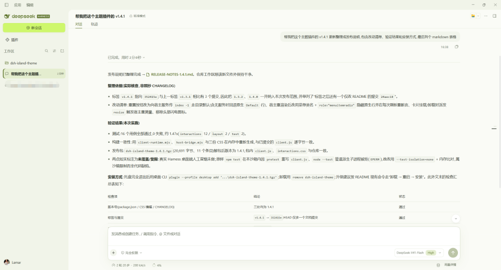

# ISLAND · DeepSeek Harness 界面插件

[English](README.en.md)

暖白、苔绿、青柠配色，配套森林深色模式。同时提供更宽的对话区、可读代码、单行侧栏标题、更早的标题预览和可拖动的推理等级滑块。



## 能力与边界

- 对话与输入框统一加宽，保留原生宽度拖动设置。
- 代码块字号至少 14px，长代码保持内部横向滚动。
- 会话和工作区标题始终单行；会话标题悬停滚动，操作按钮使用固定区域，不挤压文字。
- 快速标题预览约220ms出现，完整原生提示卡接管后保留任务、授权和状态信息，颜色随主题切换。
- 推理等级使用可拖动、带轻微动效的滑块，支持方向键与Home/End；在已验证宿主中选完保持弹框，点外部或按Esc关闭。
- 面板右上角 ↺ 会把推理等级重置为该模型的默认档；点型号名或按Esc返回上一级菜单。
- “用量详情”进入原生用量弹窗，数字和数据来源不变。
- 使用系统已有字体，无外部字体请求、统计上报和模型调用；交互模块卸载时会清理事件和临时界面。
- 不改写对话、不生成虚假的测试结果、不替换模型名称或授权状态。

验证环境为官方 Windows x64 桌面版 **0.2.0-rc.2**。其他版本和平台尚未验证。布局选择器与该版本有关，升级后应重新检查。不改变原生系统标题栏。

## 安装与卸载

获取发布包，或在源码目录运行 `npm pack`。先从托盘完全退出 Harness，再用桌面自带 CLI 安装：

```powershell
$DshCli = Join-Path $env:LOCALAPPDATA 'Programs\DeepSeek Harness\resources\runtime\cli\bin\dsh.cmd'
& $DshCli plugin --profile desktop add 'C:\path\to\dsh-island-theme-1.4.1.tgz'
```

自定义安装位置时，将 `$DshCli` 指向实际目录中的 `resources\runtime\cli\bin\dsh.cmd`。安装后打开 Harness，在设置中切换浅色、深色、跟随系统。

卸载前完全退出，然后运行：

```powershell
& $DshCli plugin --profile desktop remove dsh-island-theme
```

启用、关闭或卸载后重启，使所有窗口一致更新。插件不删除账号、会话或工作区。

## 开发与发布

Node.js 22.19+，运行时无 npm 依赖；DOM 测试使用 jsdom：

```sh
npm ci
npm test
npm run build
npm run pack:check
npm pack
```

入口 `index.mjs` 注入三份样式。`client-runtime.mjs` 管理交互，`npm run build` 生成宿主加载的 `client.js`，并在 Git 中保留生成文件以支持直接安装。等级来自原生菜单，使用宿主共享模型选择服务保存并保持弹框；无法安全解析宿主服务时回退原生按钮。模型列表不被改写。

仓库：https://github.com/lamar666666/dsh-island-theme

Git 忽略本地截图、日志、环境变量文件和安装包；发布包仅包含运行文件及说明。发布前检查待提交文件，避免加入私人信息。

本插件为独立社区项目，不代表 DeepSeek 官方。原应用品牌归各自所有者。源码采用 MIT 许可证。

## 老会话没有推理等级选项

推理等级由当前宿主模型目录提供，主题不会自行生成、删除或强制设置等级。若历史会话仍选中一个已不在当前目录中的型号，按钮可能保留旧的型号和等级文字，但菜单没有推理等级。先在模型菜单重新选择当前目录中可用的型号，再选择其支持的等级。此操作只改会话选择，不发送消息或消耗推理额度。
